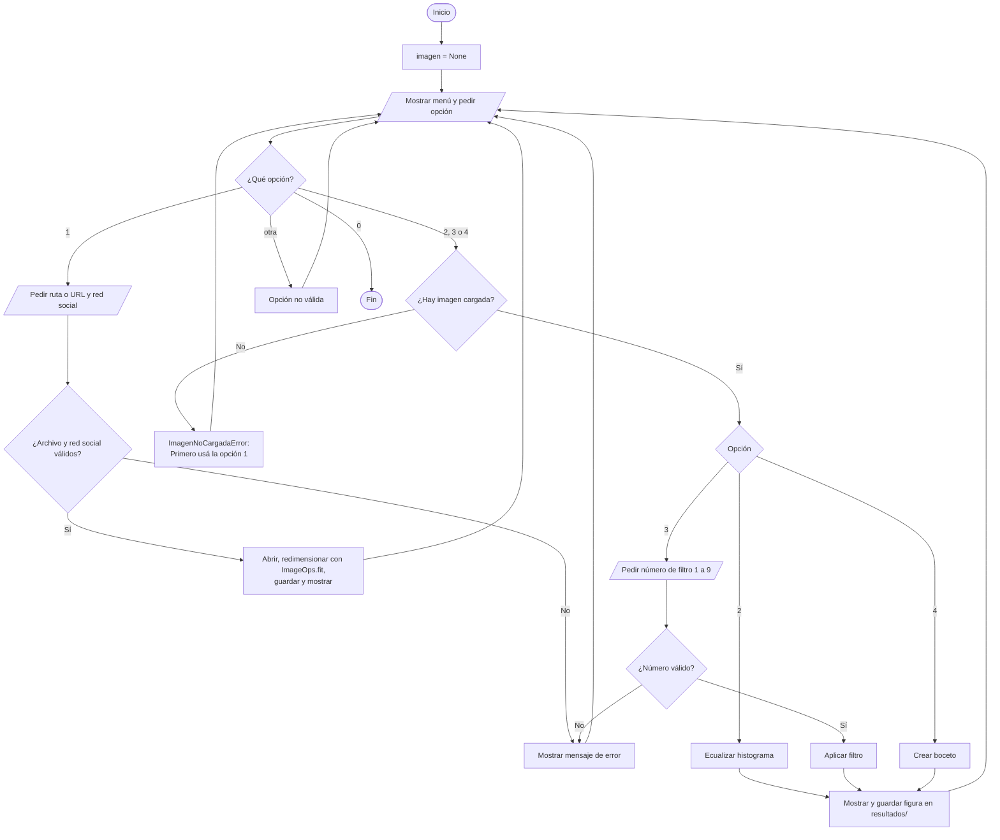
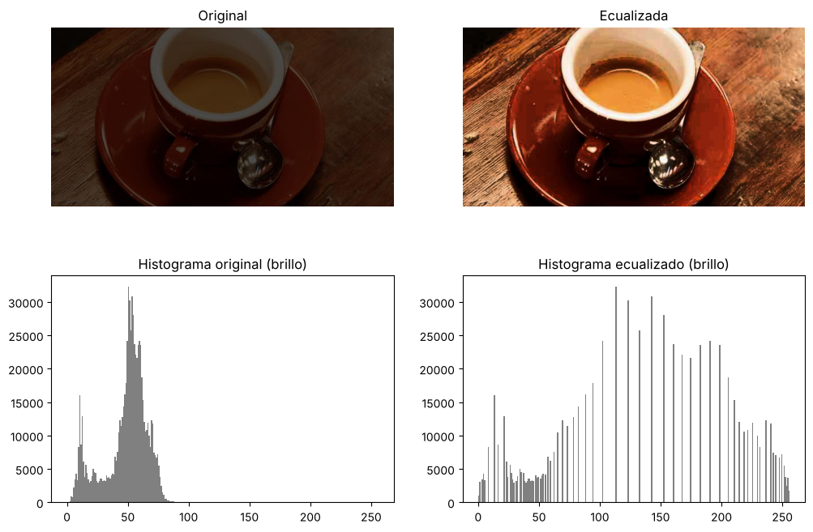
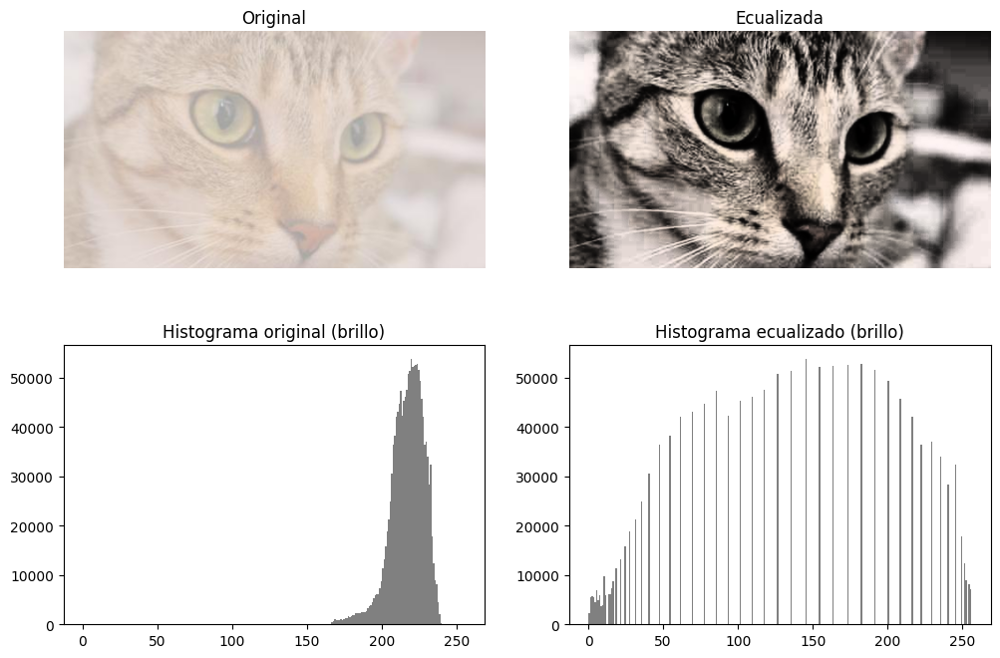
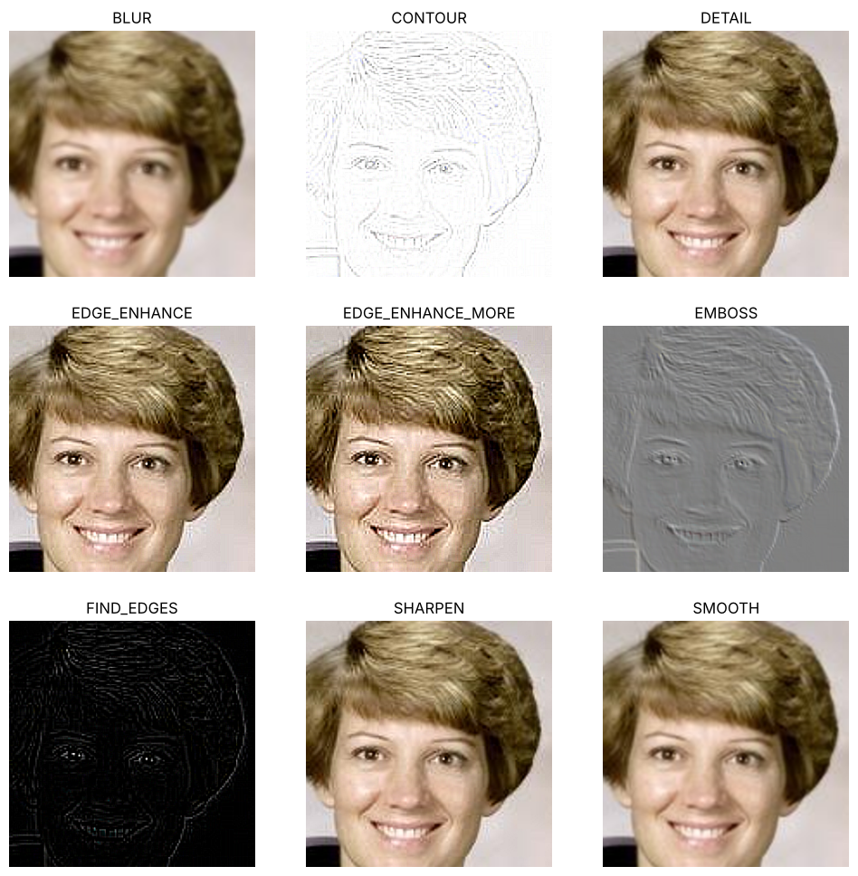
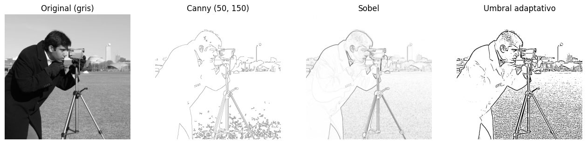

# FotoApp 📷

**Proyecto 2 - Programación Python Avanzada** · Tecnicatura Universitaria en Tecnologías de Programación (UPSO) · 2026

**Integrantes:** Hernandez Veronica - Hernandez Gabriela

App para editar fotos y prepararlas para redes sociales. Permite:

1. **Abrir y redimensionar** una foto (archivo o URL) al tamaño recomendado de Youtube, Instagram, Twitter o Facebook, sin deformarla.
2. **Ajustar el contraste** ecualizando el histograma.
3. **Aplicar uno de los 9 filtros** de Pillow.
4. **Crear un boceto** resaltando bordes y contornos (Canny, Sobel y umbral adaptativo).
5. Usar todo desde un **menú** que obliga a cargar la foto antes de editarla.

## Archivos

| Archivo / carpeta | Contenido |
|---|---|
| `fotoapp.py` | Módulo con todas las funciones y el menú |
| `fotoapp_testdev.ipynb` | Notebook donde se prueba cada función |
| `imagenes/` | Fotos de prueba |
| `resultados/` | Figuras e imágenes generadas |
| `requirements.txt` | Bibliotecas necesarias |

## Tamaños usados para cada red social

| Red social | Tamaño (ancho x alto) | Proporción | Uso |
|---|---|---|---|
| Youtube | 1280 x 720 | 16:9 | Miniatura de video |
| Instagram | 1080 x 1080 | 1:1 | Publicación cuadrada |
| Twitter (X) | 1600 x 900 | 16:9 | Imagen en un posteo |
| Facebook | 1200 x 630 | 1.91:1 | Imagen horizontal / link |

Para no deformar la foto se usa `ImageOps.fit`: escala la imagen manteniendo la proporción y recorta lo que sobra desde el centro.

## Cómo usarlo

```bash
pip install -r requirements.txt
python fotoapp.py            # abre el menú en la terminal
```

O desde Python / un notebook:

```python
import fotoapp
img = fotoapp.redimensionar_para_red("imagenes/cohete.jpg", "Instagram")
fotoapp.aplicar_filtro(img, "Emboss")
```

## Diagrama de flujo del menú



(El mismo diagrama también está como imagen en `diagrama_flujo_menu.png`.)

## Resultados

### Ecualización: foto oscura y foto sobreexpuesta



### Comparación de los 9 filtros


### Boceto con tres técnicas


> Las fotos de prueba son imágenes de ejemplo de scikit-image. La foto oscura y la sobreexpuesta se simularon cambiando el brillo de fotos normales.
